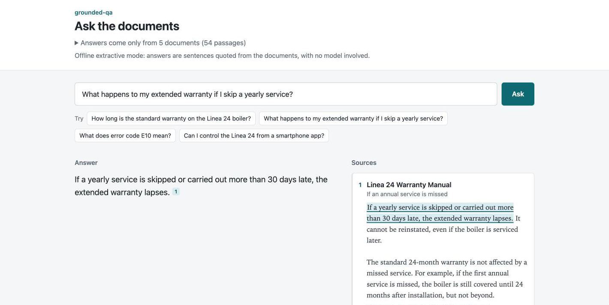

# grounded-qa

Answers questions from a company's own documents, shows the source of every claim, and says so when the documents do not contain the answer.



## Why

Support teams and customers ask the same questions every week, and the answers already exist somewhere in manuals, terms and policies that nobody reads end to end. A search box returns documents, not answers. A chatbot returns answers, but you cannot tell which ones it made up. In customer-facing work a wrong answer is worse than no answer: it becomes a warranty dispute or a wrong repair.

This project takes the narrow path between the two: short answers, each claim linked to the exact sentence it came from, and a plain "the documents do not cover this" when that is the truth.

The sample corpus is a fictional heating-equipment maker, Northwind Heating: a warranty manual, maintenance terms, an installer FAQ, a spare parts policy, and a technical guide supplied as a PDF.

## Quickstart

You need Python 3.11+ and [uv](https://docs.astral.sh/uv/). From a clone of this repository:

```bash
uv sync
uv run gqa index samples/northwind/docs
uv run gqa ask --offline "What happens to my extended warranty if I skip a yearly service?"
```

Offline mode needs no API key. It answers by quoting the best-supported sentences:

```
╭─ Answer · offline extractive mode ─────────────────────────────────────────╮
│                                                                            │
│  If a yearly service is skipped or carried out more than 30 days late,     │
│  the extended warranty lapses. [1]                                         │
│                                                                            │
╰────────────────────────────────────────────────────────────────────────────╯
[1] Linea 24 Warranty Manual — If an annual service is missed
    samples/northwind/docs/linea-24-warranty.md
    "If a yearly service is skipped or carried out more than 30 days late, the
    extended warranty lapses."
```

And for something the documents do not cover:

```
╭─ Not in the documents · offline extractive mode ───────────────────────────╮
│                                                                            │
│  The documents do not cover this. Please ask Northwind technical support   │
│  (support@northwind-heating.example).                                      │
│                                                                            │
╰────────────────────────────────────────────────────────────────────────────╯
```

`make demo` indexes the samples and asks four questions; `make serve` starts the web UI on http://127.0.0.1:8000.

To have Claude write the answers, give the SDK credentials and drop `--offline`:

```bash
export ANTHROPIC_API_KEY=sk-ant-...   # or run `ant auth login` once
uv run gqa ask "What happens to my extended warranty if I skip a yearly service?"
uv run gqa serve --examples samples/northwind/questions.yaml
```

If no credentials are found, or the API rejects them on the first call, the commands switch to offline mode and say so instead of failing.

## How it works

1. **Ingest.** Markdown, text and PDF files are split by heading and paragraph into chunks of up to about 900 characters, with a sentence or two of overlap when a section has to be split. PDFs are read with PyMuPDF; larger font lines become section headings and every chunk keeps its page number. Each chunk records its document, section, page and character offsets. The index is a JSON file (plus a `.npy` file if dense vectors are used) in `.gqa_index/`.
2. **Retrieve.** BM25, implemented in [`bm25.py`](src/groundedqa/bm25.py) on top of numpy, ranks the chunks. If an embedder is configured, its ranking is merged with BM25 by reciprocal rank fusion.
3. **Check support.** Each retrieved chunk gets a support score: the share of the question's terms, weighted by IDF, that the chunk contains. A term the corpus never uses carries the most weight, so "Do you sell solar panels?" scores low everywhere. Below the threshold (0.5) the answer is "not in the documents" and no model is called.
4. **Answer.** The top chunks go to Claude as plain-text document blocks with citations enabled. Each citation in the response points at a character range in one chunk; those become the `[1]` markers and the highlighted passages. An answer with no citations, or one that opens with "The documents do not cover this.", counts as a refusal.
5. **Offline.** Without credentials, the best-supported sentences of the top chunks are quoted word for word, in the same answer format.

```
  docs (.md .txt .pdf)
          |
       ingest ------> chunks with title, section, page, offsets ---> .gqa_index/
                                                                         |
  question --> BM25 (+ optional dense, fused) --> top k chunks <---------+
                                                       |
                                     support below threshold? --yes--> "The documents do not cover this."
                                                       | no
                               Claude with citations  or  offline: quote best sentences
                                                       |
                               answer with [n] markers + cited passages, highlighted
```

## Evaluation

[`samples/northwind/questions.yaml`](samples/northwind/questions.yaml) has 24 questions about the sample corpus: 17 that the documents answer, each with the section that answers it, and 7 they do not. A few are phrased with words the documents never use, the way customers actually write.

`make eval` runs them in offline mode, with no API calls. This is the real output:

```
Offline extractive mode, k=5, min support 0.50
24 questions: 17 answerable, 7 not covered by the documents

  retrieval hit@1              16/17     94.1%
  retrieval hit@5              17/17    100.0%
  citation correctness         15/17     88.2%
  refusal accuracy             22/24     91.7%
    answerable but declined        2
    should have declined           0

Misses
  callout-fee-year-four: declined (support 0.41), expected source at rank 5
  refund-unused-part: declined (support 0.36), expected source at rank 1
```

- **Retrieval hit@k**: an expected source is among the top k chunks.
- **Citation correctness**: the answer is not a refusal and cites at least one expected source.
- **Refusal accuracy**: the system declined exactly the questions the documents do not cover.

Per-question results, including the answer text and what was cited, go to `eval_results.json`.

Read these numbers with care:

- I wrote both the documents and the questions, so they share more vocabulary than real users and real manuals would. Treat the set as a regression check, not a benchmark.
- The 0.5 threshold was chosen on this same set. At 0.4, two of the seven unanswerable questions get through; at 0.6, four answerable ones are declined.
- Both misses are vocabulary gaps: "a repair visit in the fourth year" against "call-out fee ... in years 3 to 5", and "a part I never used" against "unused parts". BM25 cannot bridge them, and because the support check runs before the model, Claude mode would decline them too.
- Claude mode is not scored here. With credentials, `uv run gqa eval samples/northwind/questions.yaml` produces the same report from Claude's answers; it makes one API call per question that passes the support check (15 of the 24).

## Using it on your documents

```bash
uv run gqa index path/to/your/docs --index-dir .our_index
uv run gqa ask --index-dir .our_index "How many days do customers have to return an item?"
uv run gqa serve --index-dir .our_index
```

- Supported formats are `.md`, `.txt` and `.pdf`. PDFs must contain text; scanned PDFs need OCR first.
- Section headings end up in the citations, so documents with clear headings give clearer sources.
- Set `GQA_CONTACT` to whoever should get the questions the documents cannot answer.
- Write a question file for your own documents. Twenty or thirty real questions taken from support tickets, including some the documents cannot answer, are enough to choose a threshold and to notice when a change makes things worse.
- `gqa ask --show-retrieval` prints the retrieved chunks with their scores and support, which is the first thing to look at when an answer is wrong.

### Dense retrieval

No embeddings provider is required or bundled. To add one, write a factory that returns an object with a `name` and an `embed(texts)` method returning one vector per text, and pass it when indexing:

```python
# our_embeddings.py
import numpy as np
from sentence_transformers import SentenceTransformer


class MiniLM:
    name = "all-MiniLM-L6-v2"

    def __init__(self):
        self.model = SentenceTransformer(self.name)

    def embed(self, texts):
        return np.asarray(self.model.encode(list(texts)))


def make():
    return MiniLM()
```

```bash
uv run --with sentence-transformers gqa index path/to/your/docs --embedder our_embeddings:make
```

The embedder is recorded in the index and used again for queries. The support check stays lexical, so with dense retrieval on you will probably want a lower threshold or a semantic check of your own.

## Configuration

Settings are read from the environment, or from a `.env` file (see [`.env.example`](.env.example)).

| Variable | Default | Meaning |
| --- | --- | --- |
| `ANTHROPIC_API_KEY` | unset | API key. Alternatively, a profile from `ant auth login`. |
| `GQA_MODEL` | `claude-opus-5-5` | Model used for answers. |
| `GQA_INDEX_DIR` | `.gqa_index` | Where the index is written and read. |
| `GQA_TOP_K` | `5` | Chunks retrieved and sent to the model. |
| `GQA_MIN_SUPPORT` | `0.5` | Support below which a question is declined. |
| `GQA_CONTACT` | `the team that maintains these documents` | Who to suggest when the answer is not in the documents. |
| `GQA_EMBEDDER` | unset | Dense embedder for `gqa index`, as `package.module:factory`. |

The Claude request uses low effort and up to 2,000 output tokens, and leaves out the `thinking` parameter, since this model thinks adaptively by default. It does not use structured outputs, which the API does not allow together with citations. It opts into server-side fallback (`betas=["server-side-fallback-2026-07-01"]`, `fallbacks="default"`), so a request declined by the model's safety checks is retried on the model Anthropic recommends; this needs `anthropic` 1.15 or later, which `pyproject.toml` requires. Refusals and answers cut off at the token limit are reported as such, never shown as normal answers.

## Project layout

```
src/groundedqa/
  documents.py    load .md, .txt and .pdf into text plus headed sections
  chunking.py     split sections into chunks that keep their offsets
  text.py         tokenizer, stemmer, sentence splitter
  bm25.py         BM25 ranking
  dense.py        optional embedder interface and rank fusion
  index.py        build, save and load the index
  retrieval.py    search and the support score
  claude.py       the Messages API call with citations
  citations.py    map citations back to chunks and character ranges
  extractive.py   offline answers
  pipeline.py     support check, Claude or offline, fallback
  evaluation.py   the eval command
  cli.py          gqa index | ask | eval | serve
  web/            FastAPI app, one template, one stylesheet, one script
scripts/make_sample_pdf.py   renders the sample technical guide to PDF
```

`make test` runs the test suite. It needs no network and no key: the Claude path is tested with response objects built from the SDK's own types, and one test runs the real SDK against a local HTTP server to check the request on the wire.

## Limits, and what I would add for production

- **Access control.** Anyone who can reach the server can query every indexed document. A real deployment needs per-user permissions stored on the chunks and applied at retrieval time, before ranking, so restricted text never reaches the model.
- **Incremental re-indexing.** `gqa index` rebuilds everything. The manifest already stores a SHA-256 per file; the next step is re-processing only changed files, on a schedule, from wherever the documents live (SharePoint, Google Drive, Confluence).
- **Dense retrieval.** The interface is in place but no provider is wired in. Both evaluation misses are vocabulary gaps that embeddings would close, and the support check would then need a semantic signal as well.
- **Monitoring.** Log every question with what was retrieved, the support score, the answer and its citations, plus a thumbs up or down from the user. Declined questions are worth reading every week: they are the list of what the documents are missing.
- **Scale.** The index lives in memory and is rebuilt at startup. That is fine for thousands of chunks; beyond that, use a search engine or a database with full-text and vector search.
- **Language.** The tokenizer and stemmer are English only. Documents in Italian or other languages need their own stopwords and stemmer.
- **Conversation.** Every question stands alone. Follow-ups such as "and for LPG?" need the previous turn folded into the question before retrieval.
- **Document quality.** Tables are flattened to text, and PDF headings are guessed from font size. Badly structured documents give vaguer citations.

---

Built by Gabriele Delfini at G.P.G. Tech (Rome). Need this on your documents? See https://www.progettogpgtechsrl.it
